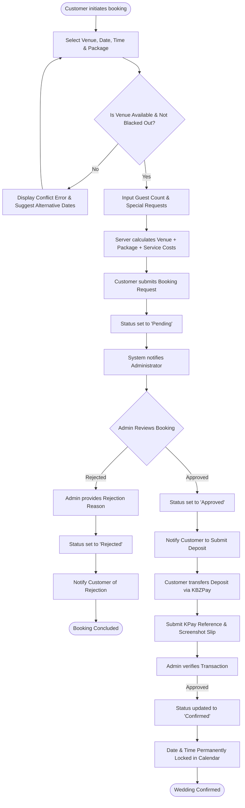
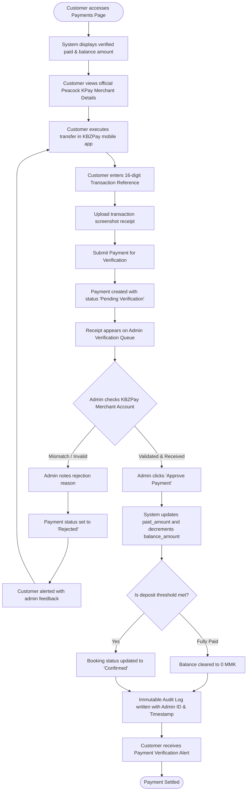
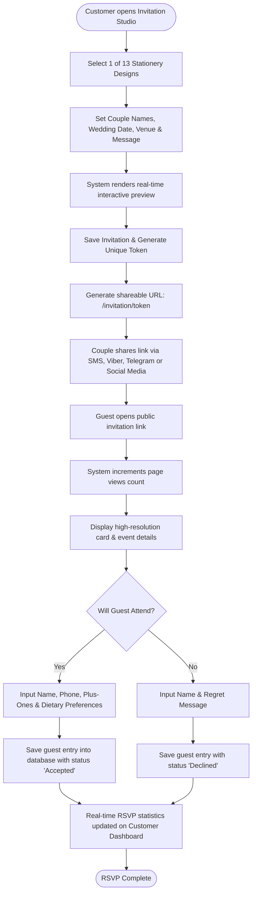

# ACTIVITY DIAGRAMS
# PEACOCK – Smart Wedding Reception Management System

---

## 1. Booking Workflow Activity Diagram

This activity diagram illustrates the multi-stage lifecycle of a wedding reception reservation, from customer venue selection to conflict validation, admin review, and confirmation.

---

## 2. KBZPay Manual Payment Verification Activity Diagram

This diagram details the financial reconciliation workflow ensuring zero automated fabricated payments and strict human administrative oversight.

---

## 3. Digital Invitation & Guest RSVP Activity Diagram

