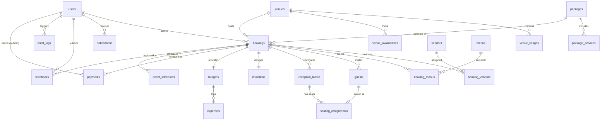

# PEACOCK – Entity Relationship Diagram

The following Mermaid diagram visualizes the relational architecture of the Peacock platform across all 22 core tables.

## Entity Cardinalities Summary
- **1-to-Many:** `users` -> `bookings`, `venues` -> `venue_images`, `packages` -> `package_services`, `bookings` -> `guests`, `bookings` -> `reception_tables`, `budgets` -> `expenses`, `bookings` -> `payments`, `bookings` -> `event_schedules`.
- **Many-to-Many (via junction):** `bookings` <-> `vendors` (via `booking_vendors`), `bookings` <-> `menus` (via `booking_menus`), `reception_tables` <-> `guests` (via `seating_assignments`).
- **1-to-1:** `bookings` <-> `invitations`, `bookings` <-> `budgets`.
