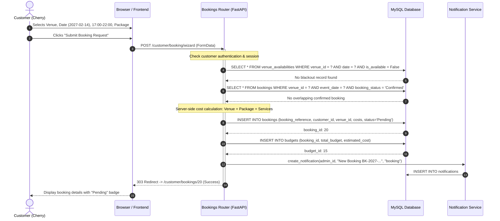
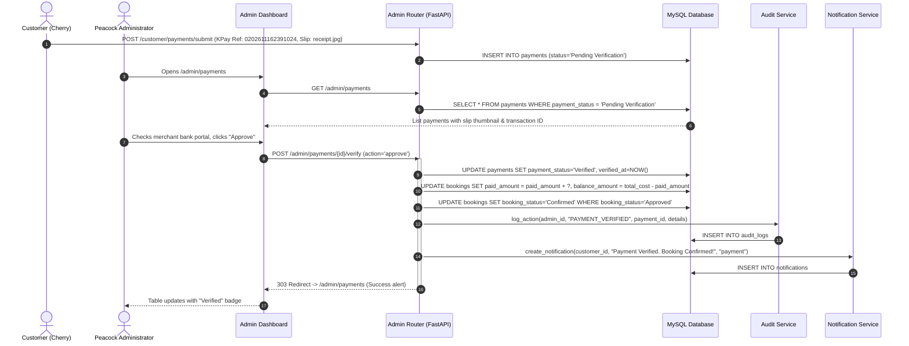
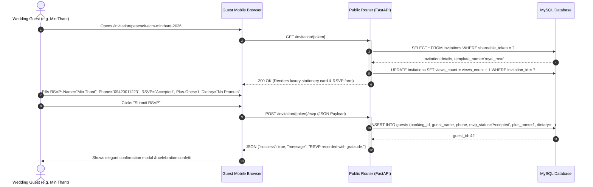

# SEQUENCE DIAGRAMS
# PEACOCK – Smart Wedding Reception Management System

---

## 1. Booking Creation with Real-Time Conflict Check

The sequence diagram below shows the interaction between the Customer Browser, FastAPI Booking Router, Database Engine, and Notification Service when submitting a new wedding reservation.

---

## 2. KBZPay Payment Verification & Balance Settlement

---

## 3. Digital Invitation & Guest RSVP Submission

