# USE CASE DIAGRAMS
# PEACOCK – Smart Wedding Reception Management System

---

## 1. System Use Case Overview

The PEACOCK platform serves three actors:
1. **Public Visitor / Unauthenticated Guest**
2. **Wedding Customer (Cherry / Registered Couple)**
3. **Administrator**

Below is the Mermaid Use Case diagram representing the primary interactions and boundaries.

```mermaid
flowchart LR
    subgraph Actors
        G["Public Guest"]
        C["Wedding Customer (Cherry)"]
        A["Administrator"]
    end

    subgraph Public_Platform["Public Platform"]
        UC01["Browse Venues & Hall Details"]
        UC02["Compare Wedding Packages"]
        UC03["View Catering & Vendor Services"]
        UC04["View Digital Wedding Invitation"]
        UC05["Submit Online RSVP & Dietary Notes"]
        UC06["Register / Login / Reset Password"]
        UC07["Toggle Theme (Light / Dark)"]
    end

    subgraph Customer_Portal["Customer Planning Portal"]
        UC08["Submit Conflict-Free Booking Wizard"]
        UC09["Manage Profile & Encrypted Contact"]
        UC10["Select Banquet Catering Portions"]
        UC11["Manage Guest Roster & RSVP Status"]
        UC12["Design Digital Invitation (13 Templates)"]
        UC13["Visual Banquet Seating Planner"]
        UC14["Track Wedding Budget & Expenses"]
        UC15["Submit KBZPay Reference & Receipt"]
        UC16["Build Reception Event Day Timeline"]
        UC17["Submit Post-Event Verified Review"]
    end

    subgraph Admin_Portal["Administrator Portal"]
        UC18["Review Executive Dashboard & Real Analytics"]
        UC19["Approve / Reject Booking Requests"]
        UC20["Set Blackout / Maintenance Dates"]
        UC21["Verify KBZPay Receipts & Reconcile Balances"]
        UC22["Manage Venues, Packages & Catering CRUD"]
        UC23["Export Reports (CSV & Styled PDF)"]
        UC24["Inspect Immutable Security Audit Logs"]
        UC25["Moderate Customer Reviews & Feedback"]
    end

    %% Public connections
    G --> UC01
    G --> UC02
    G --> UC03
    G --> UC04
    G --> UC05
    G --> UC06
    G --> UC07

    %% Customer connections
    C --> UC06
    C --> UC07
    C --> UC08
    C --> UC09
    C --> UC10
    C --> UC11
    C --> UC12
    C --> UC13
    C --> UC14
    C --> UC15
    C --> UC16
    C --> UC17

    %% Admin connections
    A --> UC06
    A --> UC07
    A --> UC18
    A --> UC19
    A --> UC20
    A --> UC21
    A --> UC22
    A --> UC23
    A --> UC24
    A --> UC25
```

---

## 2. Detailed Actor Descriptions

### 2.1 Public Guest
- Browses available luxury venues, hall capacities, rental pricing, and photographs.
- Explores wedding packages, curated menus, and master vendors.
- Accesses customized wedding invitations via private tokenized URL (`/invitation/{shareable_token}`).
- Submits attendance confirmation, plus-one headcount, and dietary preferences directly into the database.

### 2.2 Wedding Customer (e.g. Cherry)
- Self-registers and logs in via secure session cookies.
- Creates new booking requests with server-side conflict detection.
- Selects catering packages (traditional Myanmar banquets and international cuisine) with custom portion calculations.
- Arranges table seating plans with hard capacity constraints.
- Monitors itemized wedding budget (Estimated vs Actual Spend).
- Transfers funds via KBZPay (KPay), entering the 16-digit transaction ID and uploading payment receipts for verification.

### 2.3 Administrator
- Approves or declines wedding bookings with documented reasons.
- Inspects customer payment slips against KBZ merchant accounts and verifies transactions.
- Schedules blackout dates for hall renovations or national holidays.
- Manages the full catalog of venues, packages, menus, and master vendors.
- Generates downloadable CSV tables and ReportLab PDF executive summaries.
- Monitors system activity and financial modifications in the immutable audit log.
